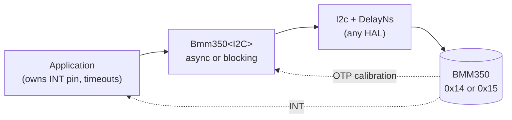

# bmm350

Driver for the Bosch BMM350 three-axis magnetometer over I2C, written for the MARV V2 Rev 1 flight controller (RP2354B). `no_std`, no `unsafe`. The crate root is the async driver, written against `embedded-hal-async` 1.0 (I2C and delay); the `blocking` module is the same code run to completion on `embedded-hal` 1.0 types. The only other dependency is `defmt` 1.0, optional. The driver owns no interrupt pin, timer or task. Version 0.1.0; the API may still change.

On crates.io the package is named `bmm350-async` (the name `bmm350` belongs to another crate). Depend on it with `bmm350-async = "0.1.0"`; the library is still called `bmm350`, so the code says `use bmm350::...`.



## Quick start

```rust,no_run
# use core::convert::Infallible;
# use embedded_hal_async::i2c::{ErrorType, Operation};
# struct Bus;
# impl ErrorType for Bus { type Error = Infallible; }
# impl embedded_hal_async::i2c::I2c for Bus {
#     async fn transaction(&mut self, _: u8, _: &mut [Operation<'_>]) -> Result<(), Infallible> { Ok(()) }
# }
# struct Delay;
# impl embedded_hal_async::delay::DelayNs for Delay {
#     async fn delay_ns(&mut self, _: u32) {}
# }
use bmm350::{Averaging, Bmm350, Config, DEFAULT_ADDRESS, OutputDataRate};
use embedded_hal_async::{delay::DelayNs, i2c::I2c};

async fn run<I: I2c>(i2c: I, delay: &mut impl DelayNs) -> Result<(), bmm350::Error<I::Error>> {
    let mut mag = Bmm350::new(i2c, DEFAULT_ADDRESS);
    let config = Config::new()
        .with_odr(OutputDataRate::Hz100)
        .with_averaging(Averaging::Avg2);
    mag.init(delay, &config).await?;

    // The application owns the INT pin: wait for the data-ready edge here, and put any timeout
    // around that wait, never around a driver call.
    let field = mag.read_field().await?; // field.x, .y, .z in microtesla, .temperature in degC
    let _ = field;

    let timed = mag.read_with_time().await?; // timed.sample (counts), timed.sensor_time (ticks)
    let _ = timed;
    let report = mag.self_test(delay).await?; // report.passed(), report.entries
    let _ = report;
    Ok(())
}
```

The blocking front-end has the same methods without `.await`: `bmm350::blocking::Bmm350::new(i2c, address)`, with an `embedded_hal::delay::DelayNs`.

## Docs

| Page | In one line |
|---|---|
| [docs/driver.md](docs/driver.md) | What the driver does, what the application provides, rules for correct use, what is not covered |
| [docs/device.md](docs/device.md) | Bus protocol, registers, power modes, timing, interrupt, pins, datasheets |
| [docs/compensation.md](docs/compensation.md) | OTP read, conversion to microtesla, temperature and cross-axis compensation |
| [hil/README.md](hil/README.md) | On-board test programs and how to run them |

## Status

- Host tests: `cargo test --locked` (unit and property tests; the README example is a `no_run` doctest).
- On the board (MARV V2 Rev 1, I2C0, one sensor): smoke, ops, self-test and cancel programs pass; see [hil](hil/README.md).
- Not run on the real chip: `with_axes`, `with_watchdog`, open-drain INT, rates of 25 Hz and below, forced power modes through `set_power_mode`, address 0x15; see [driver](docs/driver.md).
- Cargo feature `defmt` (off by default) adds `defmt::Format` to the public data, configuration and error types.

## Used by

The MARV V2 flight-controller firmware ([MARV-FC](https://github.com/Lmx154/MARV-FC)) pins this crate.

## MARV project

| Repository | Role |
|---|---|
| [MARV-FC](https://github.com/Lmx154/MARV-FC) | Flight-controller firmware for the MARV V2 board (RP2350B) |
| [MARV-GCS](https://github.com/Lmx154/MARV-GCS) | Ground station (`marv-gcs`) and command line (`marv-cli`) |
| [MARV-sim](https://github.com/Lmx154/MARV-sim) | Simulator that runs the firmware's flight code |
| Sensors | [icm45686](https://github.com/Lmx154/icm45686-rs) · [lsm6dsk320x](https://github.com/Lmx154/lsm6dsk320x-rs) · [bmp581](https://github.com/Lmx154/bmp581-rs) · **bmm350** · [sam-m10q](https://github.com/Lmx154/sam-m10q) · [adc-battery](https://github.com/Lmx154/adc-battery) |
| Board I/O | [pio-sdmmc](https://github.com/Lmx154/pio-sdmmc-rs) · [qmi-psram](https://github.com/Lmx154/qmi-psram-rs) · [ws2812c](https://github.com/Lmx154/ws2812c-rs) · [usb-cdc](https://github.com/Lmx154/usb-cdc) · [pio-uart](https://github.com/Lmx154/pio-uart) |
| Motors and links | [dshot](https://github.com/Lmx154/dshot-rs) · [esc-passthrough](https://github.com/Lmx154/esc-passthrough) · [rc-port](https://github.com/Lmx154/rc-port) · [crsf-codec](https://github.com/Lmx154/crsf-codec) · [mavlink-device](https://github.com/Lmx154/mavlink-device) · [marv-dialect](https://github.com/Lmx154/marv-dialect) |
| Other drivers | [lc76g](https://github.com/Lmx154/lc76g-rs) (Quectel LC76G GNSS) |

## License

MIT, see `LICENSE`. The driver is written from the datasheet listed in [docs/device.md](docs/device.md); facts that come only from Bosch's `BMM350_SensorAPI` are marked in the crate and no code is copied from it.
