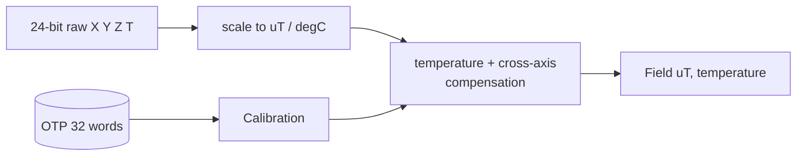

# Calibration and compensation

Part of [bmm350](../README.md)

The BMM350 stores per-unit calibration in OTP. `init` reads it once (32 words) and the driver turns raw counts into microtesla and degrees Celsius with it. The datasheet gives only the OTP register layout; the word layout, constants and formulas come from Bosch's `BMM350_SensorAPI` v1.10.0 (`bmm350.c`, `bmm350_defs.h`, BSD-3-Clause), marked as such in the crate.

## OTP read

| Step | Detail |
|---|---|
| Command | write OTP_CMD_REG 0x50 = 0x20 OR word (command 001 DIR_READ in bits 7:5, word 0-31 in bits 4:0) |
| Wait | 300 us, then poll OTP_STATUS 0x55 until bit 0 otp_cmd_done = 1; bits 7:5 nonzero is an error (1 boot, 2 page read, 3 page program, 4 sign, 5 invalid command) |
| Data | OTP_DATA_MSB 0x52, OTP_DATA_LSB 0x53; word = (MSB << 8) OR LSB |
| End | after all 32 words the vendor writes 0x80 (PWR_OFF_OTP) to OTP_CMD_REG |

## OTP words used

Bytes are signed 8-bit.

| Word | Content |
|---|---|
| 0x0D | low: temperature offset (/5 K); high: temperature sensitivity (/512) |
| 0x0E | bits 11:0 offset X (signed 12-bit); bits 15:12 offset Y bits 11:8 |
| 0x0F | low: offset Y bits 7:0; bits 11:8 offset Z bits 11:8 |
| 0x10 | low: offset Z bits 7:0; high: sensitivity X (/256) |
| 0x11 | low: sensitivity Y; high: sensitivity Z (/256) |
| 0x12, 0x13, 0x14 | low: TCO X, Y, Z (/32); high: TCS X, Y, Z (/16384) |
| 0x15 | low: cross X-Y; high: cross Y-X (/800) |
| 0x16 | low: cross Z-X; high: cross Z-Y (/800) |
| 0x18 | signed 16-bit, T0 = value/512 + 23 degC |

Offsets are added to values already in uT.

## Data registers

X 0x31-0x33, Y 0x34-0x36, Z 0x37-0x39, temperature 0x3A-0x3C, each little-endian (XLSB, LSB, MSB), read as one 12-byte burst from 0x31. The datasheet describes 21 significant bits in a 24-bit register (p13); the vendor sign-extends all 24 bits. Reset value of every data byte 0x7F.

## Conversion

| Quantity | Formula |
|---|---|
| X, Y | raw * 0.007069979 uT/LSB |
| Z | raw * 0.007174964 uT/LSB |
| Temperature | raw * 0.000981282 - 25.49 degC, then corrected as below |

The field constants are (1e6 / 2^20) divided by the gain products (14.55 * 19.46 for X and Y, 9.0 * 31.0 for Z) times (1/1.5) * 0.714607238769531. Temperature uses 1 / (0.00204 * (1/1.5) * 0.714607238769531 * 2^20).

## Compensation

1. T = (1 + t_sens) * (degC raw - 25.49) + t_offs.
2. Per axis: B = raw_uT * (1 + sens) + offset + tco * (T - T0), then B = B / (1 + tcs * (T - T0)).
3. With d = 1 - cross_y_x * cross_x_y: X = (Bx - cross_x_y * By) / d; Y = (By - cross_y_x * Bx) / d; Z = Bz + (Bx * (cross_y_x * cross_z_y - cross_z_x) - By * (cross_z_y - cross_x_y * cross_z_x)) / d.

The macros `BMM350_SENS_CORR_Y` (0.01) and `BMM350_TCS_CORR_Z` (0.0001) exist in `bmm350_defs.h` but `bmm350.c` v1.10.0 never uses them.

Range is +-2000 uT per axis and the vector sum must stay below 2000 uT (p19). Noise is 190 nT rms on X and Y and 450 nT rms on Z at 100 Hz, averaging 2 (p10).

## Code

`src/data.rs` (raw sample, conversion), `src/lib.rs` (`init` reads the OTP into `Calibration`; `read_otp_word`).

## Related

[device](device.md) · [driver](driver.md) · [README](../README.md)
