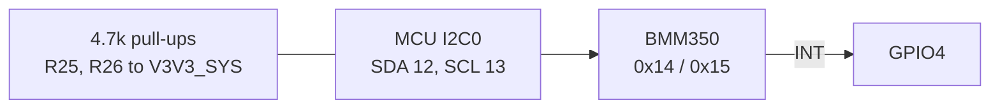

# BMM350 device facts

Part of [bmm350](../README.md)

Bus, register, power-mode, timing, interrupt and board facts the driver was written against (MARV V2 Rev 1, magnetometer on I2C0). Page numbers are PDF pages of datasheet BST-BMM350-DS001-27 (rev 1.27). "Vendor" is Bosch's `BMM350_SensorAPI` v1.10.0 (`bmm350.c`, `bmm350_defs.h`), used only where the datasheet defers to the API (OTP layout, compensation, delays). Figures labelled observed were seen on the MARV V2 board.

## Bus

- Supplies: VDD 1.72-1.98 V, VDDIO 1.72-3.6 V (p8).
- I2C 7-bit address 0x14 with ADSEL low, 0x15 with ADSEL high; ADSEL is sampled at boot and must not float (p44-45). A scan of 0x08-0x77 answered at 0x14 only.
- Standard, fast and fast+ modes, no clock stretching (p44); 400 kHz works. Reset state is I2C; I3C is not used.
- Read protocol: every read returns 2 dummy bytes first; an n-byte read is n+2 bytes, discard the first 2 (p46; vendor `BMM350_DUMMY_BYTES`). The register address auto-increments. A write is register, data pairs (p45). A burst read that starts at the sensortime, magnetic or temperature registers freezes their update until it ends; single reads can mix samples (p18).

## Registers (p26-43)

| Register | Address | Fields |
|---|---|---|
| CHIP_ID | 0x00 | 0x33, read-only (p29) |
| ERR_REG | 0x02 | bit 0 pmu_cmd_error, clears on read |
| PAD_CTRL | 0x03 | bits 2:0 drive, reset 0x07 |
| PMU_CMD_AGGR_SET | 0x04 | bits 5:4 avg, bits 3:0 odr, reset 0x14 |
| PMU_CMD_AXIS_EN | 0x05 | bit 0 x, bit 1 y, bit 2 z, reset 0x07 (p31; the map on p28 says 0x70, treated as a typo) |
| PMU_CMD | 0x06 | bits 3:0 command |
| PMU_CMD_STATUS_0 / _1 | 0x07 / 0x08 | see below; _1 reports effective odr (bits 3:0) and avg (bits 5:4) |
| I2C_WDT_SET | 0x0A | I2C watchdog |
| INT_CTRL | 0x2E | see Interrupt |
| INT_CTRL_IBI | 0x2F | I3C only |
| INT_STATUS | 0x30 | bit 2 drdy_data_reg, clears on read |
| Data | 0x31-0x3C | magnetic X Y Z and temperature, see [compensation](compensation.md) |
| SENSORTIME | 0x3D-0x3F | |
| OTP_CMD_REG, OTP_DATA_MSB, OTP_DATA_LSB, OTP_STATUS | 0x50, 0x52, 0x53, 0x55 | see [compensation](compensation.md) |
| TMR_SELFTEST_USER, CTRL_USER | 0x60, 0x61 | self-test (p17) |
| CMD | 0x7E | soft reset |

Soft reset: write 0xB6 to CMD, then 0x00 (p22, p43); the vendor writes only 0xB6, waits 24 ms, and waits 3 ms after power-on. Datasheet: OFF to suspend 2.5 ms typical, suspend to normal 70 ms typical (p8). The OTP is accessible again after every reset and the boot ends with 0x80 in OTP_CMD_REG (p14).

## Power modes (PMU_CMD, p32)

| Code | Command | Meaning |
|---|---|---|
| 0x00 | SUS | suspend (state after boot) |
| 0x01 | NM | normal |
| 0x02 | UPD_OAE | apply odr and avg |
| 0x03 | FM | forced, full recharge |
| 0x04 | FM_FAST | forced, fast recharge; for trigger rates of 25 Hz and above; the only way to 200 Hz |
| 0x05 / 0x06 | FGR / FGR_FAST | flux-guide reset |
| 0x07 / 0x08 | BR / BR_FAST | bit reset |

Forced mode starts only from suspend and returns to suspend when done; a forced request in normal mode or during a running forced conversion is ignored (ERR_REG pmu_cmd_error) (p15-16). In normal mode only SUS and UPD_OAE are accepted. If more than 0.1 s passes between init and the first forced trigger, use FM, not FM_FAST (p15).

PMU_CMD_STATUS_0 (p33): bit 0 busy, bit 1 odr_ovwr, bit 2 avg_ovwr, bit 3 pwr_mode_is_normal, bit 4 cmd_is_illegal, bits 7:5 last command value (3 bits, so BR_FAST reads 7). Right after init it was seen to read 0x11 (busy and cmd_is_illegal set, not yet normal) and 0x28 (normal, last command NM) two seconds later; the cause of the transient illegal flag is UNKNOWN.

Magnetic reset (vendor `bmm350_magnetic_reset_and_wait`; datasheet p17), chip in suspend: write PMU_CMD = 0x07 (BR), wait 14 ms, STATUS_0 bits 7:5 must read 7; write PMU_CMD = 0x05 (FGR), wait 18 ms, bits 7:5 must read 5. The device resets itself after each boot and on every conversion in normal and forced mode; a manual reset is for field shocks and after a suspend longer than 2 s. A reset can keep STATUS_0 bit 0 busy for up to 8 ms (p22).

## Timing

- Vendor mode-change delays: normal to suspend 6 ms; suspend to normal 38 ms; suspend to forced 15 / 17 / 20 / 28 ms for avg 1 / 2 / 4 / 8, fast forced 4 / 5 / 9 / 16 ms; UPD_OAE 1 ms. Datasheet: forced conversion under 5 ms (avg 1, FM_FAST) up to 30 ms (avg 8, FM) (p15).
- Maximum forced trigger rate with FM_FAST: 200 / 150 / 80 / 40 Hz for avg 1 / 2 / 4 / 8 (p16).
- ODR codes (PMU_CMD_AGGR_SET bits 3:0, p30): 0x02 400 Hz, 0x03 200, 0x04 100, 0x05 50, 0x06 25, 0x07 12.5, 0x08 6.25, 0x09 3.125, 0x0A 1.5625 Hz. Accuracy +-2 % typical at room temperature, +-4 % over temperature (p9); observed 100.68 Hz at the 100 Hz setting and 402.7 Hz at 400 Hz.
- Averaging codes (bits 5:4): 0 none, 1 = 2 samples, 2 = 4, 3 = 8. Allowed (p15 Table 5): 400 Hz avg 0 only; 200 Hz avg 0-1; 100 Hz avg 0-2; 50 Hz and below avg 0-3. The vendor lowers an excessive avg to the highest allowed. After writing odr/avg send UPD_OAE; the next odr/avg update must wait for a data-ready after the busy flag clears (p32).
- Axis enable (PMU_CMD_AXIS_EN) is effective in suspend only and ignored on the fly in normal mode; the vendor refuses to disable all three (p20). Registers of disabled axes keep stale data.

## Interrupt (INT_CTRL 0x2E, p35)

| Bit | Field |
|---|---|
| 0 | int_mode: 1 latched, 0 pulsed |
| 1 | int_pol: 1 active high |
| 2 | int_od: 1 push-pull, 0 open-drain |
| 3 | int_output_en (maps the interrupt to the pin; reserved on A samples) |
| 7 | drdy_data_reg_en |

Reset 0x00 = open-drain, active low, pulsed, disabled. Push-pull, active high, pulsed, data-ready on = 0x8E (the vendor example expects the same; observed read-back 0x8E, one rising edge per sample). In pulsed mode INT_STATUS clears itself after 1.25 ms (p20). INT pulse width: UNKNOWN.

## Pins and bus (MARV V2)

All GPIO are 3.3 V logic and not 5 V tolerant.

| GPIO | Net | Function |
|---|---|---|
| 12 | MAG_SDA | I2C0 SDA, IO block row 5, 4.7k pull-up R25 |
| 13 | MAG_SCL | I2C0 SCL, IO block row 6, 4.7k pull-up R26 |
| 4 | PWM6 | servo S6 pad; the BMM350 INT is attached here as a plain GPIO input |

The pull-ups go to V3V3_SYS and the module is powered from the V3V3_SYS pin of the IO block. How the breakout derives its 1.8 V supply from the 3.3 V pin: UNKNOWN. The INT wire is attached by hand; the PCB provides the pins above.

## Datasheets

| Device | URL |
|---|---|
| BMM350 datasheet (BST-BMM350-DS001-27) | https://www.bosch-sensortec.com/media/boschsensortec/downloads/datasheets/bst-bmm350-ds001.pdf |
| BMM350 Bosch Sensor API (BSD-3-Clause) | https://github.com/boschsensortec/BMM350_SensorAPI |

## Related

[driver](driver.md) · [compensation](compensation.md) · [hil](../hil/README.md) · [README](../README.md)
