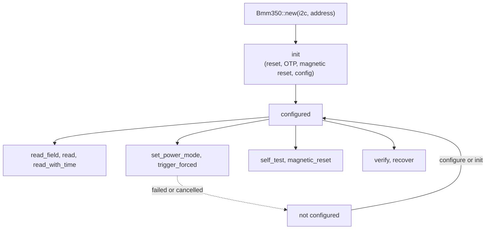

# Driver

Part of [bmm350](../README.md)

What `Bmm350<I2C>` offers, what the application must provide, and the rules that keep reads correct. Register facts are in [device](device.md); the conversion maths is in [compensation](compensation.md).

## What the application provides

| Item | Detail |
|---|---|
| I2C bus | `embedded_hal_async::i2c::I2c` (async) or `embedded_hal::i2c::I2c` (`blocking`) |
| Address | `DEFAULT_ADDRESS` 0x14 (ADSEL low) or `ADDRESS_ADSEL_HIGH` 0x15 |
| Delay | `DelayNs` for `init`, `configure`, `recover`, `self_test`, `set_power_mode` and the magnetic resets |
| INT pin | `init` configures the chip's output (`InterruptPin`); the application waits on the pin, and after `init` waits for the next data-ready edge |

## What the driver does

| Area | API |
|---|---|
| Settings | `Config` (`#[non_exhaustive]`; `new()` with `with_odr`, `with_averaging`, `with_axes`, `with_start_mode`, `with_interrupt`, `with_watchdog`), applied by `init` and `configure`; `Config::validate` rejects no axis and an averaging the rate does not allow (`ConfigError`). `InterruptPin`: data-ready on or off, pulsed or latched, push-pull or open-drain, polarity. `I2cWatchdog` |
| Power | `set_power_mode` (`PowerMode`), `trigger_forced`, `trigger_forced_fast`, `timing::forced_measurement_us`, `timing::forced_fast_max_rate_hz` |
| Reads | `read_field` (microtesla and degC); `read` (`RawSample` counts); `compensate` with `Calibration` read from the chip's OTP by `init` |
| Timed read | `read_with_time` (sample and sensor time in one transaction), `sensor_time`; `timing::sensor_ticks_elapsed`, `sensor_elapsed_us`, `sensor_elapsed_us_with_period` (24-bit wrap handled), `sensor_time_us` (no wrap handling). One tick is 1/25600 s |
| Self-test | `self_test`: X and Y, both polarities (none for Z). `SelfTestReport` holds four `SelfTestEntry` (axis, polarity, field without and with stimulus, `delta`, `passed`); an entry passes if the compensated field moves at least `selftest::MIN_DELTA_UT` (130 uT) in the stimulus direction. A completed test that misses the limit is `Ok` with `passed()` false. Runs in suspend, includes a full magnetic reset, re-applies the configuration |
| Resets | `magnetic_reset` (full recharge, as `init` does), `magnetic_reset_fast`; `exceeds_high_field(&Field)`: magnitude above 2000 uT (`selftest::HIGH_FIELD_LIMIT_UT`) or not finite |
| Status | `pmu_status`, `error_status` (reading clears `ERR_REG`), `interrupt_status` (clears the flag) |
| Health | `verify`, `recover`, `config`, `calibration`, `release` |
| Raw access | `read_register`, `write_register`, `read_registers`, `read_otp_word`, register map in `reg`; a raw write can leave the chip in a state the applied `Config` does not describe |

## Rules for correct use

- Never cancel an I2C transfer in flight: no timeout or `select` around a driver call that is on the bus; put the timeout around the wait for data-ready. On embassy-rp 0.10 a cancelled read makes later reads return wrong data with no error: without recovery 161 of 182 cancelled reads were followed by a wrong read; with `recover` after each cancel there were 0 wrong checking reads of 9600 over 1858 cancels at 100 kHz, 400 kHz and 1 MHz, and no register changed.
- `recover` is the way back after any doubt: it waits 2 ms with no bus traffic, makes one discarded `CHIP_ID` read, checks the identity twice, then runs `verify`. It writes nothing. A data line held low needs a bus clear by whatever holds the bus; a driver that holds only an `I2c` cannot do it. `verify()` reads back the registers the applied `Config` owns, changes nothing, and returns `Error::ConfigMismatch` after two differing reads. It compares configuration, not liveness: a chip stalled by a latched-interrupt reconfiguration passed it once; check that data-ready edges keep coming or that `sensor_time` advances.
- `Error::NotConfigured`: the typed methods (reads, `set_power_mode`, triggers, resets, `self_test`, `verify`, `interrupt_status`) return it until `init` has completed (`configure` needs an earlier `init`: it reads the calibration). It is also returned after a failed or cancelled `init`, `configure`, `set_power_mode` or `self_test`; call `configure` or `init` again. A `set_power_mode` refused with `Error::WrongMode` leaves the driver configured. `sensor_time`, `pmu_status`, `error_status` and raw access work whenever the bus works.
- Latched interrupt and data-ready: with a latched interrupt, `configure` and `set_power_mode` to suspend read `INT_STATUS`, which consumes a pending data-ready flag. `Info::data_ready_consumed` (from `configure`) reports it; `set_power_mode` does not.
- Magnetic resets are legal in suspend only; in normal mode they return `Error::WrongMode` and send nothing. Use one after a field beyond the high-field limit, after a field shock, or (full pair) before leaving a suspend longer than about 2 s: `set_power_mode(Suspend)`, reset, `set_power_mode(Normal)`. Apart from `init` and `self_test`, the driver never runs one on its own.
- Sensor time is not a clock: it is the time of the last sample from the sensor's own oscillator, in steps of one sample period; in suspend it stands still; two equal readings can mean "no new sample"; it drifts against the host clock.
- On this HAL I2C is interrupt-driven, not DMA. `read` is 14 bytes and fully queued before the first await (up to 15 bytes). `read_with_time` is 17 bytes, more than the HAL queues at once, so a cancel during it can leave a transfer in flight; `recover` restored correct reads after each of 318 such cancels.
- After a forced trigger wait `timing::forced_measurement_us` before the next command; the busy flag is still set at the data-ready edge.

## Observed timing (MARV V2 Rev 1, RP2354B, embassy-rp 0.10, I2C0 at 400 kHz, one sensor)

| Item | Value |
|---|---|
| Self-test stimulus | +174.0 / -173.9 uT on X, +174.1 / -174.1 uT on Y, against the 130 uT limit |
| Offset left after `self_test` | at most 0.2 uT per axis over 50 samples |
| `self_test` time | 113.7 ms from the default configuration, 96.1 ms from a configuration that starts in suspend |
| `magnetic_reset_fast` / `magnetic_reset` | 12.6 ms / 32.6 ms; field afterwards within 0.3 uT of before |
| Plain read / `read_with_time` | 465 us / 539 us (medians) |
| Sensor time | exactly 256 ticks per sample at 100 Hz, 64 at 400 Hz; this unit's oscillator ran 0.7 % fast |
| Forced, command to data-ready | `FM` 14.2, 15.4, 18.9, 25.9 ms; `FM_FAST` 3.1, 4.3, 7.8, 14.8 ms (averaging 1, 2, 4, 8) |
| Data-ready edges | one per sample, none missed (200 of 200 at 100 Hz, 799 of 799 at about 400 Hz) |
| `init` | about 85 ms |

## Not covered

- Not implemented: pad drive (`PAD_CTRL`) and I3C with in-band interrupts (`reg` holds their addresses as facts only); out-of-range detection from Bosch's `bmm350_oor.c`; an automatic reset after a high field. Hard-iron and soft-iron calibration of the installed sensor is the application's job.
- Not run on the real chip: `with_axes`, `with_watchdog`, `InterruptDrive::OpenDrain`, `with_data_ready(false)`, 200 Hz or rates of 25 Hz and below, `set_power_mode` with `Forced` or `ForcedFast`, address 0x15 (only scanned for an acknowledge). `exceeds_high_field` has run on a field at rest only. The blocking front-end ran `init`, `trigger_forced` and a read. No long-duration run.

## Code

| Path | Contents |
|---|---|
| `src/lib.rs` | `Bmm350`, `Error`, `Info` |
| `src/config.rs`, `src/plan.rs` | settings and register plan |
| `src/reg.rs`, `src/image.rs` | register map and image |
| `src/data.rs`, `src/timing.rs`, `src/selftest.rs` | samples and compensation, sensor-time and forced-timing helpers, self-test |
| `src/blocking.rs` | blocking front-end |

## Related

[device](device.md) · [compensation](compensation.md) · [hil](../hil/README.md) · [README](../README.md)
